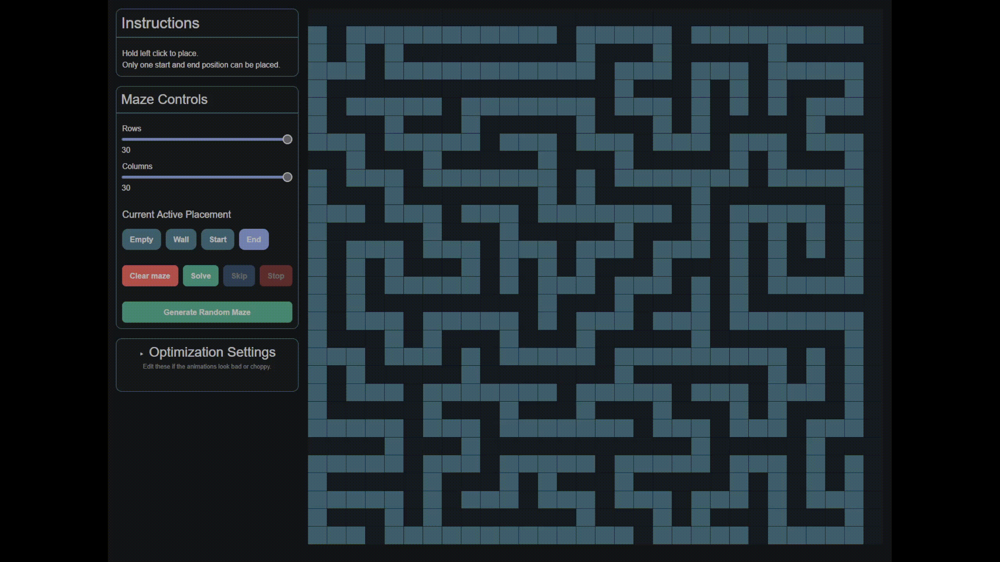
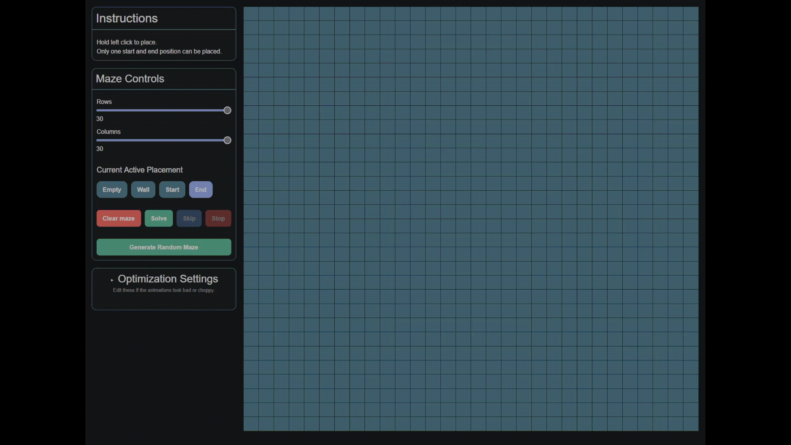

# Maze Game
A maze creator that solved by using [Breadth-First Search](https://en.wikipedia.org/wiki/Breadth-first_search), made in Blazor.

I created this project to learn some more foundational algorithms and to mess with more data structures (namely stacks and queues) on my own on a project I thought would be interesting. 

You can try it yourself at https://maze.kestondev.com

## Note 
While the site itself is setup intentionally to disallow touchscreen, this website was built with desktop users in mind. Given the way the grid is generated, it would be practically impossible for me to make this work for touchscreen users.

## Todo / Planned features 
- Inclusion of [Dijkstra's Algorithm](https://en.wikipedia.org/wiki/Dijkstra%27s_algorithm) & [A*](https://en.wikipedia.org/wiki/A*_search_algorithm) (and a weighting system to go along with it.), possibly [DFS](https://en.wikipedia.org/wiki/Depth-first_search)
- Persistance? Only if it seems to be apt
- Stats
- Auto generate options to allow auto-generating start & end points

## Architecture
While there is only the one algorithm, this is built to be easily extendable via the `IPathfindingAlgorithm` interface, and i could potentially add other maze generation options with `IMazeGenerator`.

## Features
- Animated BFS solve 
- Configurable Grid size
- Manual and Automatic maze generation (Recursive backtracker)

## Examples 

